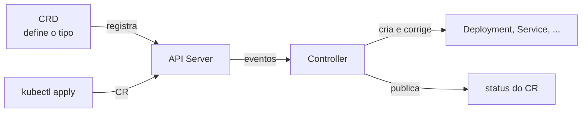
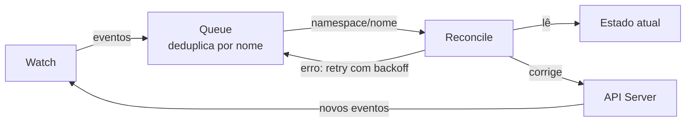
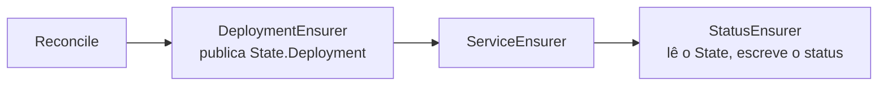

# Conceitos Básicos de Operators Kubernetes

Só o que o lab e a demo usam. Finalizer, rollout ordenado, predicates e informers estão em [`extras/`](extras/).

## Por que operators

Um Deployment sabe manter N réplicas. Ele não sabe que um componente precisa subir antes do outro, que certa troca
de versão exige parar os workers primeiro, nem como reagir quando algo cai no meio disso. Esse conhecimento costuma
morar num runbook, e um humano o executa.

Um **operator** transforma esse runbook em código que roda dentro do cluster: você declara o que quer num recurso
próprio, e um controller leva o cluster até lá e **fica lá**, corrigindo o que sair do lugar.



## CRD e CR

Uma **CustomResourceDefinition** ensina um tipo novo ao API Server: nome, campos, validação. Um **Custom Resource** é
uma instância desse tipo. Depois de instalada a CRD, `kubectl get sampleapp` funciona como `kubectl get pod`.

```yaml
apiVersion: apps.cloud104.com/v1alpha1
kind: SampleApp
metadata:
  name: sampleapp-example
spec:
  replicas: 1
  image: fmnapoli/teste-app:v2
  port: 5000
```

A CRD não se escreve à mão: ela é gerada dos tipos Go e dos marcadores `+kubebuilder`.

- `spec` é o que **você** pede. `status` é o que o **controller** observou. Com o subresource `status`, os dois têm
  escrita separada.
- A validação acontece no API Server, antes de o objeto existir. Marcadores cobrem um campo (`Minimum`, `Enum`).
  **CEL** (`XValidation`) cobre regras entre campos do mesmo objeto, sem webhook. Webhook só é necessário quando a
  regra precisa consultar algo fora do objeto.

## Controller e o loop de reconciliação



- O **manager** (controller-runtime) mantém um cache local do cluster, alimentado por watches. O `Get` do controller lê
  desse cache, que pode estar um pouco atrasado.
- O **`Reconcile`** recebe só `namespace/nome`. Ele lê o CR, lê o que existe, corrige a diferença e publica o status.
- Devolver erro recoloca na fila com backoff. `RequeueAfter` é para esperar algo que não gera evento.

## Level-triggered

O `Reconcile` não sabe qual evento o acordou, e não precisa saber. A cada passada ele olha o estado inteiro.

| | Edge-triggered | Level-triggered |
|---|---|---|
| Reage a | "este evento aconteceu" | "o estado está diferente do pedido" |
| Evento perdido | estado errado para sempre | a próxima passada corrige |
| Operator reiniciou | perdeu o que aconteceu | reconcilia tudo ao subir |

A consequência prática é **idempotência**: rodar duas vezes tem de dar no mesmo. Por isso `CreateOrUpdate`, nunca
"criar quando chegar o evento de criação".

## Owner reference e `Owns()`

Uma owner reference no filho aponta para o dono, e faz duas coisas:

- **Deleção em cascata:** apagou o CR, o garbage collector do Kubernetes apaga os filhos. Sem nenhum código nosso.
- **Drift:** `Owns(&appsv1.Deployment{})` faz o controller observar os Deployments que têm dono do seu tipo. Mudou ou
  sumiu um filho, o dono entra na fila, e o `Reconcile` restaura o desejado.

## Conditions

`status.conditions` é a lista padrão do Kubernetes para dizer em que pé as coisas estão. Cada entrada tem `type`,
`status` (`True`/`False`/`Unknown`), `reason`, `message` e `observedGeneration`. O `observedGeneration` diz se aquela
leitura já considera a última mudança do spec. `kubectl wait --for=condition=Ready` funciona sobre elas.

## Chain de ensurers

Um `Reconcile` que faz tudo cresce sem controle. O padrão usado em operators reais é uma **chain**: uma lista curta e
ordenada de ensurers, cada um dono de um recurso, dividindo um `State` criado a cada reconcile.



- A ordem é explícita, e por isso testável.
- Cada ensurer é idempotente e pequeno.
- Um nó lê do `State` o que o anterior descobriu, em vez de buscar de novo.
- O status tem um dono só, no fim, que roda mesmo se a chain parar: uma escrita por reconcile.

## Próximos Passos

Mãos à obra: [desenvolvimento do operator](03-desenvolvimento.md).
