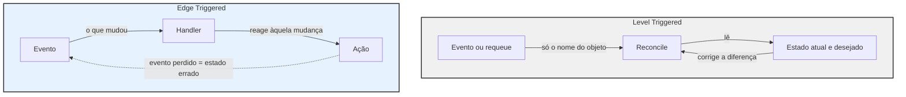
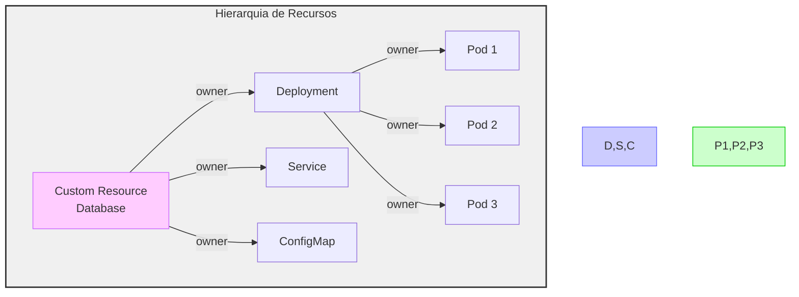
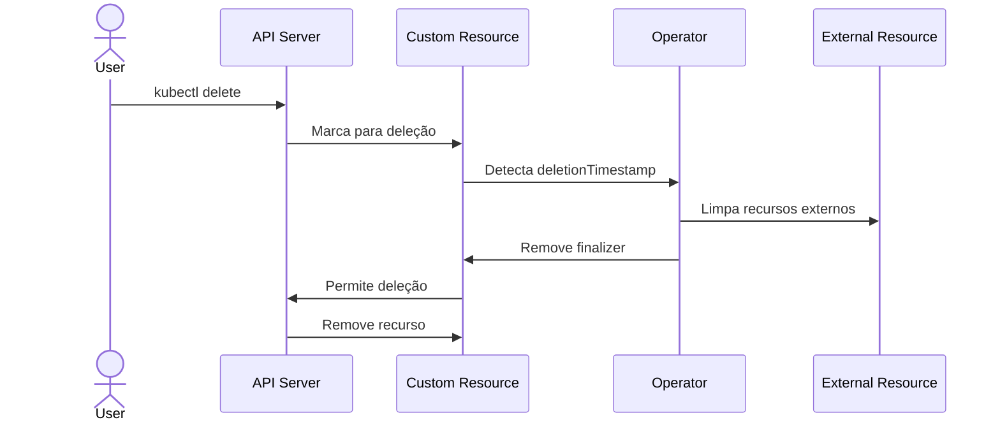
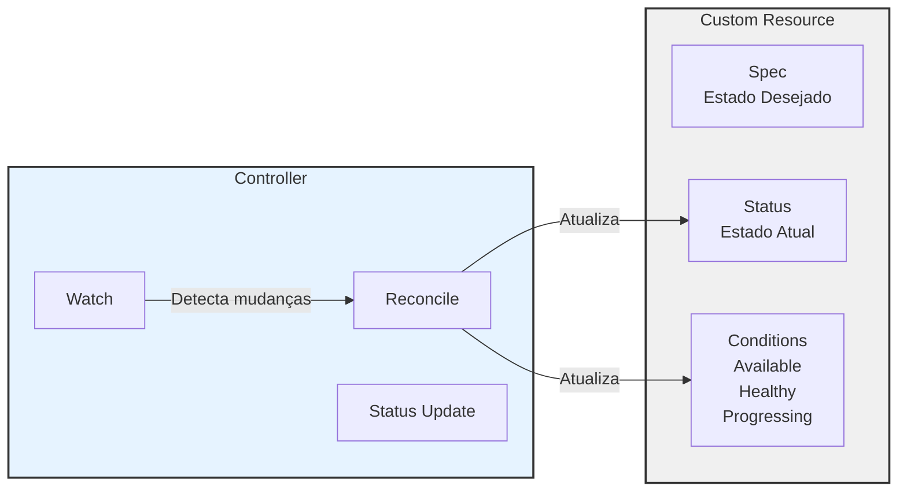
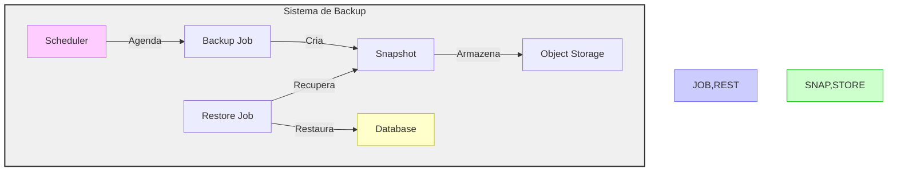
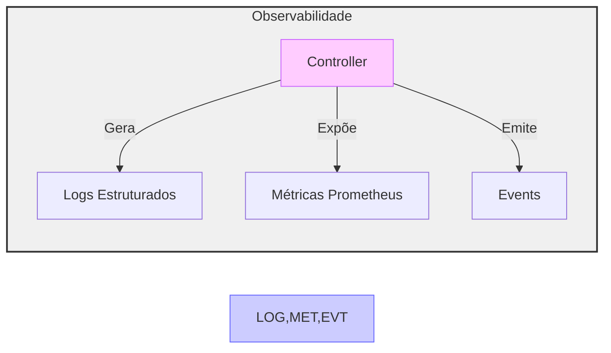
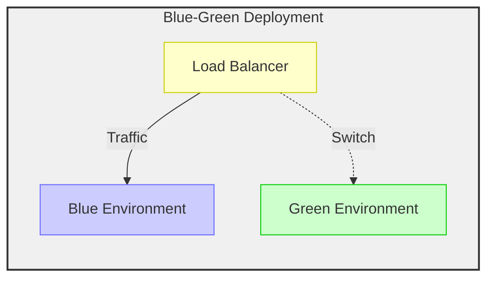
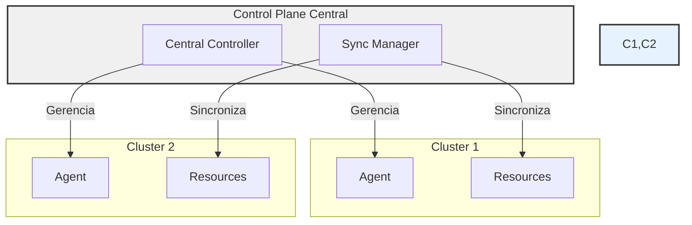

# Padrões Avançados de Design para Kubernetes Operators

## 1. Padrões de Reconciliação

### Level Triggers vs Edge Triggers

Os dois termos descrevem **o que a lógica olha**, não com que frequência ela roda. Eventos disparam o reconcile nos
dois casos.



#### Level Triggered (o modelo do controller-runtime)

- **Funcionamento**: o `Reconcile` recebe só namespace e nome, lê o estado e corrige a diferença
- **Vantagens**:
  - Evento perdido ou repetido não importa: a próxima passada corrige
  - Eventos em rajada viram uma passada só, porque a fila deduplica por nome
  - Reiniciar o operator é seguro: ao subir, ele reconcilia tudo

`Owns()` e `Watches()` decidem **quando** acordar; o que o `Reconcile` faz não depende de qual evento foi.

```go
func (r *Reconciler) SetupWithManager(mgr ctrl.Manager) error {
    return ctrl.NewControllerManagedBy(mgr).
        For(&myappv1.MyApp{}).
        Owns(&appsv1.Deployment{}).
        Watches(
            &corev1.Secret{},
            handler.EnqueueRequestsFromMapFunc(r.findAppsForSecret),
        ).
        Complete(r)
}
```

`RequeueAfter` é para o que **não gera evento**, como um estado externo que precisa ser consultado. Não é o que torna
o controller level-triggered.

```go
return ctrl.Result{RequeueAfter: time.Minute * 5}, nil
```

#### Edge Triggered

- **Funcionamento**: a ação depende do evento em si ("criaram X, então faço Y")
- **Problema**: evento perdido, por queda do operator, por exemplo, nunca é compensado

Evite em operators. Se o código precisa saber "o que mudou", normalmente falta gravar algo no status.

## 2. Gerenciamento de Recursos

### Owner References



#### Implementação

```yaml
apiVersion: v1
kind: Pod
metadata:
  ownerReferences:
    - apiVersion: databases.example.com/v1
      kind: Database
      name: prod-db
      uid: d9607e19-f88f-11e6-a518-42010a800195
      controller: true
      blockOwnerDeletion: true
```

### Finalizers



#### Ciclo de Vida

1. Adição do Finalizer
2. Solicitação de Exclusão
3. Bloqueio da Exclusão
4. Execução da Limpeza
5. Remoção do Finalizer
6. Exclusão Efetiva

## 3. Status e Condições

### Status Subresource



#### Exemplo de Status

```yaml
status:
  phase: Provisioning
  observedGeneration: 12
  conditions:
    - type: Available
      status: "False"
      reason: Creating
      message: "Criando recursos"
```

### Rollout ordenado

`CreateOrUpdate` de vários Deployments de uma vez sobe tudo junto. Quando a aplicação tem ordem (um componente migra
o banco e os outros só podem subir depois), a chain precisa de um **gate**: o ensurer só avança quando o anterior
terminou, e devolve requeue enquanto espera.

```go
if migrator.Status.AvailableReplicas < *migrator.Spec.Replicas {
    state.Waiting = "migrator"
    return nil // os nós seguintes leem state.Waiting e não sobem os workers
}
```

Pontos que mordem:

- `Available` não quer dizer "terminou": confira que o `observedGeneration` do Deployment alcançou o `generation`,
  senão você lê o status do rollout anterior.
- Health check verde pode vir antes do trabalho real. Se o componente responde 200 antes de migrar, o gate precisa de
  um sinal próprio.
- Ordem de descida costuma ser a inversa da de subida, e precisa ser modelada também: esvaziar os workers antes de
  reiniciar quem migra.

## 4. Padrões de Backup e Recuperação



## 5. Monitoramento e Observabilidade

### Métricas e Logs



#### Exemplo de Métricas

```go
var (
    reconcileTotal = prometheus.NewCounterVec(
        prometheus.CounterOpts{
            Name: "controller_reconcile_total",
            Help: "Total de reconciliações",
        },
        []string{"result"},
    )
)
```

## 6. Deployment Strategies

### Blue-Green Deployment



## 7. Multi-cluster Management



## Boas Práticas

1. **Idempotência**
   - Operações devem ser seguras para repetição
   - Use CreateOrUpdate consistentemente
   - Verifique estados antes de modificar

2. **Segurança**
   - RBAC com princípio do menor privilégio
   - Secrets gerenciados adequadamente
   - Network Policies restritivas

3. **Escalabilidade**
   - Cache eficiente
   - Rate limiting
   - Backoff em retentativas

4. **Observabilidade**
   - Logs estruturados
   - Métricas relevantes
   - Events informativos

Estas práticas garantem Operators robustos, seguros e manteníveis.
