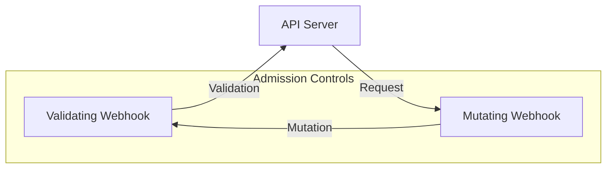
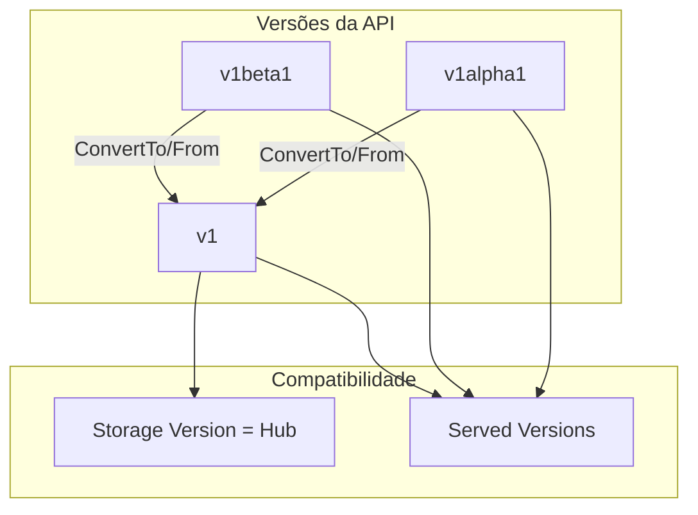
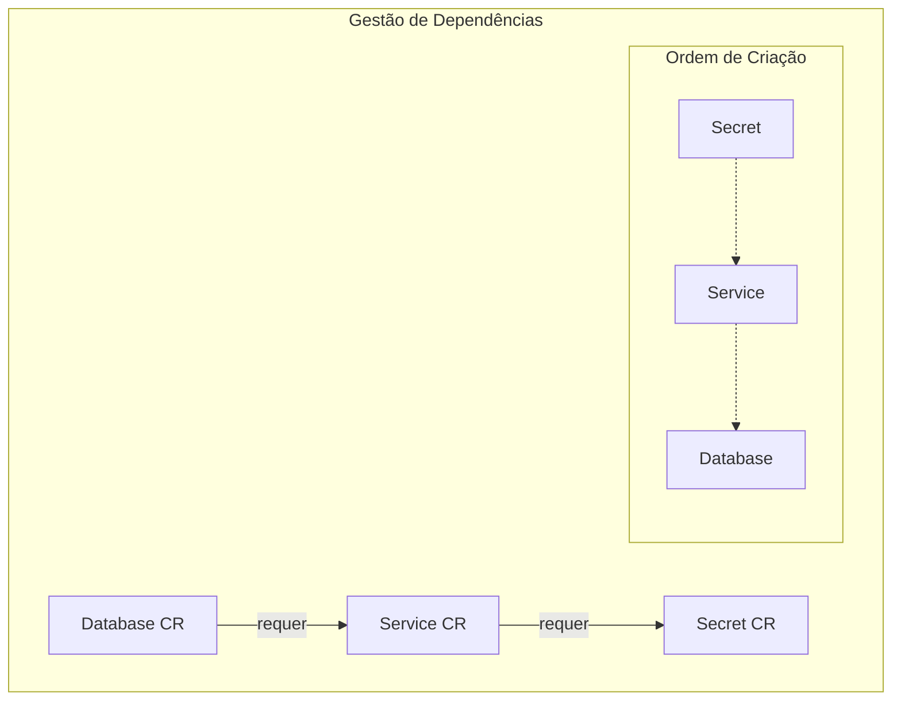
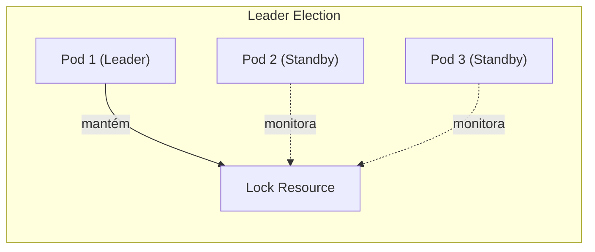
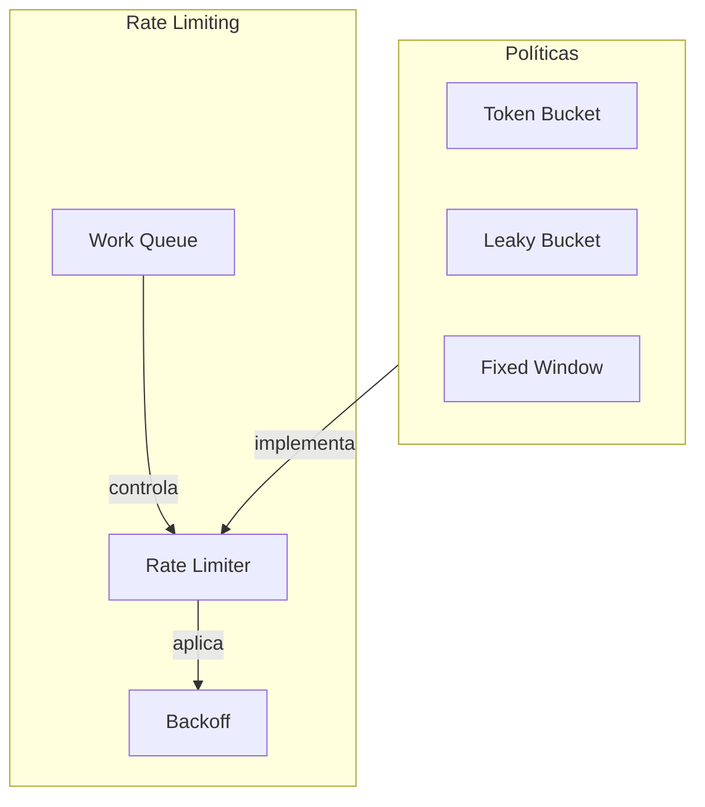
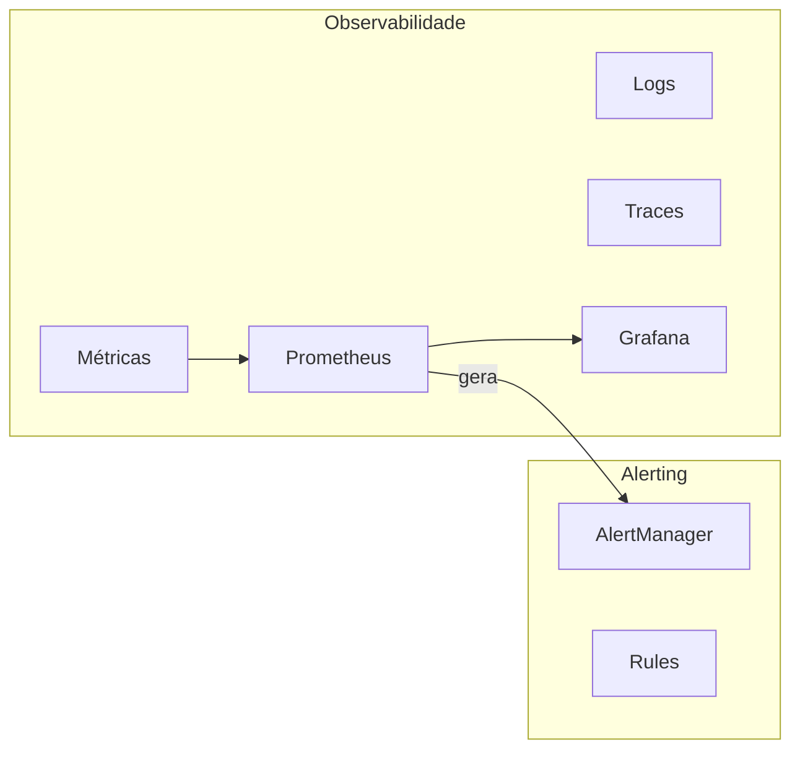
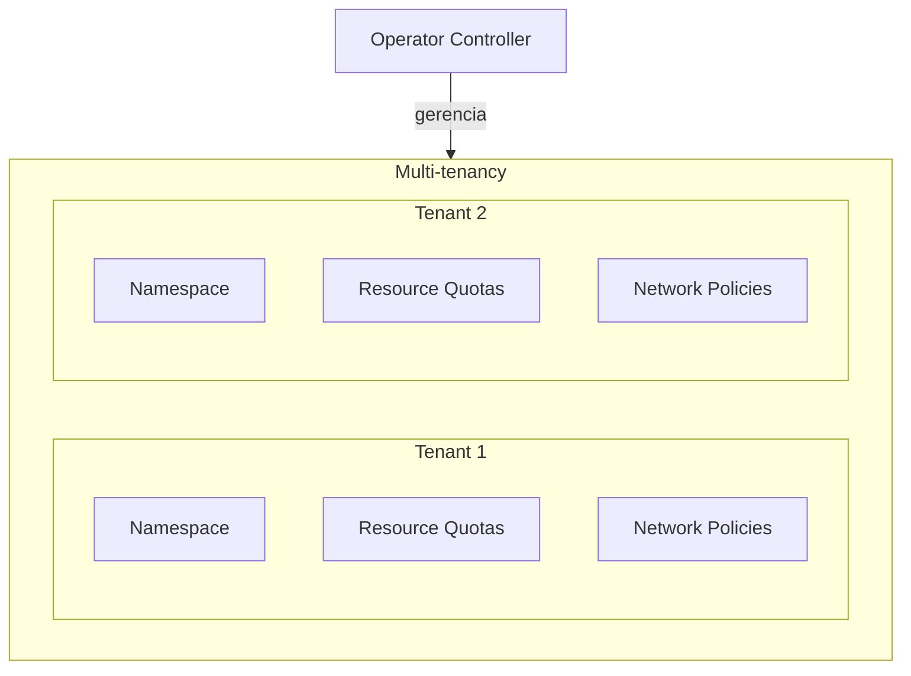

# Tópicos Avançados em Kubernetes Operators

## 1. Admission Controllers em Operators

Admission Controllers permitem validar e/ou modificar requisições ao Kubernetes antes que sejam persistidas.


### Implementação
```go
// Webhook de Validação
func (v *Validator) Handle(ctx context.Context, req admission.Request) admission.Response {
    obj := &myappv1.MyApp{}
    if err := v.decoder.Decode(req, obj); err != nil {
        return admission.Errored(http.StatusBadRequest, err)
    }
    
    // Lógica de validação
    if obj.Spec.Replicas < 1 {
        return admission.Denied("replicas must be >= 1")
    }
    
    return admission.Allowed("")
}
```

## 2. Padrões de Migração de Versão

### Estratégias de Conversão


O controller-runtime usa um modelo **Hub-and-Spoke**, não uma cadeia. A *storage version* é o **Hub**; cada outra
versão é um **Spoke** que converte direto de/para o Hub. Não existe `v1alpha1 → v1beta1 → v1`: todo spoke fala com o
hub. O handler de conversão genérico chama os métodos abaixo (pacote `sigs.k8s.io/controller-runtime/pkg/conversion`):

```go
// A storage version (hub) só marca que é o hub:
func (*v1.MyApp) Hub() {}

// Cada spoke converte de/para o hub:
func (src *v1alpha1.MyApp) ConvertTo(dstRaw conversion.Hub) error {
    dst := dstRaw.(*v1.MyApp)
    dst.ObjectMeta = src.ObjectMeta
    // ... mapeia os campos de v1alpha1 para v1
    return nil
}

func (dst *v1alpha1.MyApp) ConvertFrom(srcRaw conversion.Hub) error {
    src := srcRaw.(*v1.MyApp)
    dst.ObjectMeta = src.ObjectMeta
    // ... mapeia os campos de v1 para v1alpha1
    return nil
}
```

## 3. Gestão de Dependências


### Implementação de Dependências
```go
func (r *Reconciler) ensureDependencies(ctx context.Context, obj *myappv1.MyApp) error {
    // 1. Garantir Secret
    secret := &corev1.Secret{}
    if err := r.ensureSecret(ctx, obj, secret); err != nil {
        return fmt.Errorf("ensuring secret: %w", err)
    }
    
    // 2. Garantir Service
    svc := &corev1.Service{}
    if err := r.ensureService(ctx, obj, svc); err != nil {
        return fmt.Errorf("ensuring service: %w", err)
    }
    
    // 3. Configurar Database
    return nil
}
```

## 4. Alta Disponibilidade

### Leader Election


### Implementação
```go
func main() {
    mgr, err := ctrl.NewManager(ctrl.GetConfigOrDie(), ctrl.Options{
        LeaderElection:   true,
        LeaderElectionID: "myapp-operator",
        // Sem LeaderElectionNamespace: o manager usa o próprio namespace (in-cluster).
        // Fixar "default" colocaria o Lease no lugar errado.
    })
    // ...
}
```

Standby é estado normal, não falha: só o líder reconcilia; os demais seguram o `Lease` esperando. O resource lock
default já é `leases`. Depois que `mgr.Start` retornar, o binário deve sair na hora — perdeu o lock.

## 5. Rate Limiting e Backoff

### Estratégias de Rate Limiting


Na prática você quase nunca constrói a fila à mão: o controller já usa `workqueue.DefaultTypedControllerRateLimiter[reconcile.Request]()`
(backoff exponencial de 5 ms a 1000 s, com um teto por token bucket). Para trocar, passe `RateLimiter` em
`SetupWithManager` via `controller.Options`. Desde o client-go do k8s 1.37 as filas são **genéricas** (tipadas):

```go
// Equivalente ao default, montado à mão (note os tipos):
workqueue.NewTypedRateLimitingQueue(workqueue.NewTypedMaxOfRateLimiter[reconcile.Request](
    workqueue.NewTypedItemExponentialFailureRateLimiter[reconcile.Request](5*time.Millisecond, 1000*time.Second),
    &workqueue.TypedBucketRateLimiter[reconcile.Request]{Limiter: rate.NewLimiter(rate.Limit(10), 100)},
))
```

## 6. Métricas e Monitoramento

### Arquitetura de Observabilidade


### Métricas Customizadas
```go
var (
    reconcileTotal = prometheus.NewCounterVec(
        prometheus.CounterOpts{
            Name: "myapp_reconcile_total",
            Help: "Total number of reconciliations per status",
        },
        []string{"status"},
    )
    
    reconcileDuration = prometheus.NewHistogramVec(
        prometheus.HistogramOpts{
            Name:    "myapp_reconcile_duration_seconds",
            Help:    "Time spent doing reconciliations",
            Buckets: prometheus.DefBuckets,
        },
        []string{"status"},
    )
)
```

## 7. Multi-tenancy

### Arquitetura Multi-tenant


### Implementação
```go
// Configuração por Tenant
type TenantConfig struct {
    ResourceQuota corev1.ResourceQuota
    NetworkPolicy networkingv1.NetworkPolicy
    ServiceAccount corev1.ServiceAccount
}

func (r *Reconciler) reconcileTenant(ctx context.Context, tenant string) error {
    config := r.getTenantConfig(tenant)
    
    // Criar/atualizar recursos do tenant
    if err := r.reconcileResourceQuota(ctx, tenant, config.ResourceQuota); err != nil {
        return err
    }
    // ...
}
```

## 8. Outros padrões que o operator pode orquestrar

Fora do escopo deste material, mas o mesmo loop de reconcile serve para: estratégias de deployment (blue-green,
canary, A/B) controlando o tráfego entre versões; integração com service mesh, gerando a config do mesh a partir do
CR; e arquiteturas plugáveis, com um registro de plugins que o controller chama na reconciliação. Cada um é um
conjunto de ensurers a mais na chain, com o mesmo contrato de idempotência.

## Conclusão

O loop de reconcile é sempre o mesmo; o que muda é o que cada ensurer garante. Ao crescer um operator, as decisões
que mais importam são: validar no API Server (marcadores e CEL) antes de recorrer a webhook; planejar a storage
version e a conversão Hub-and-Spoke cedo; manter cada ensurer idempotente; e confiar no default do controller-runtime
(rate limiting, leader election, métricas) em vez de reimplementá-lo.
