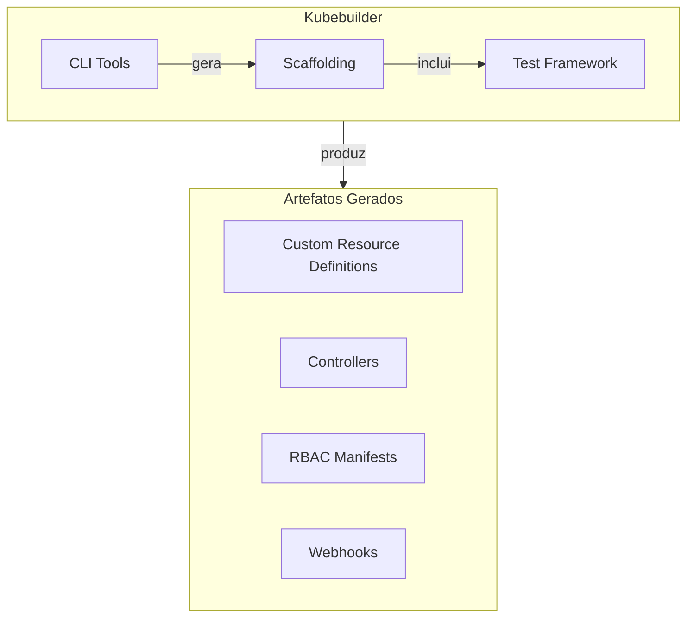
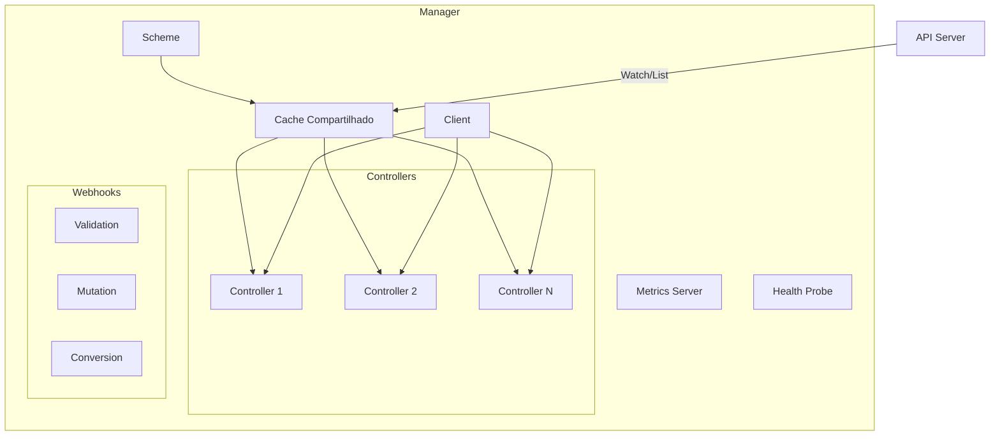
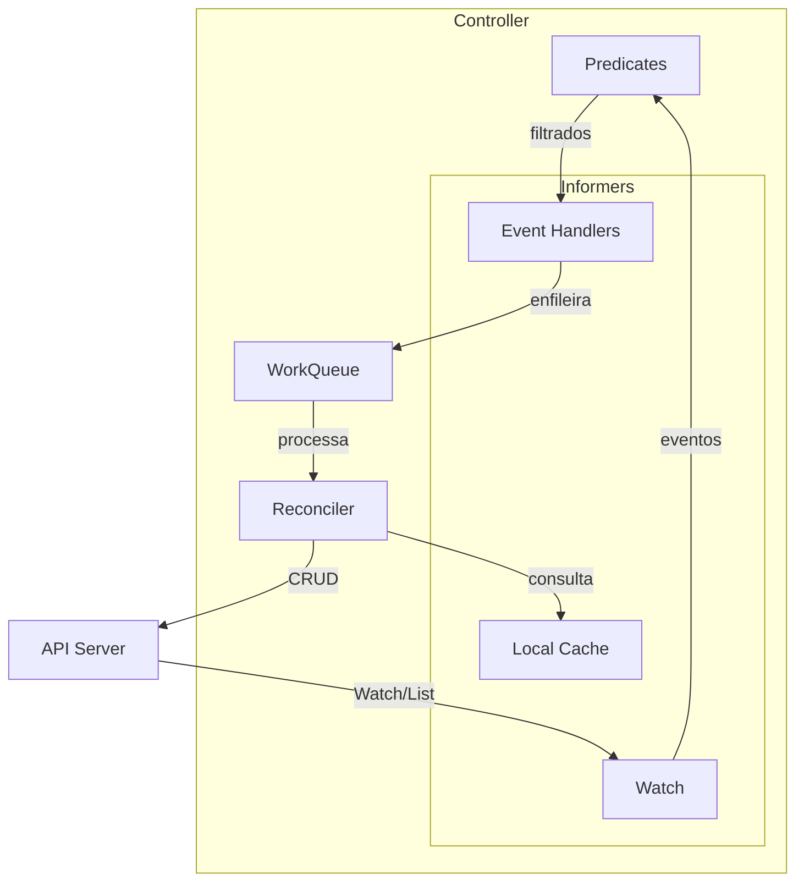
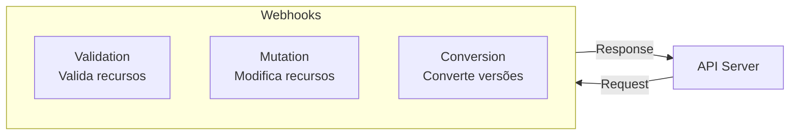

# Guia Completo do Kubebuilder

## O que é o Kubebuilder?

Kubebuilder é um framework para construir Kubernetes APIs e controllers usando CRDs (Custom Resource Definitions). Ele proporciona uma estrutura padronizada e ferramentas para desenvolver Operators de forma eficiente.


## Arquitetura do Manager

O Manager é o componente central em um projeto Kubebuilder. Ele gerencia controllers, webhooks e recursos compartilhados.


## Fluxo de um Controller

Diagrama mostrando como um controller processa recursos:


## Setup Básico

### 1. Inicialização do Projeto
```bash
# Inicializar novo projeto
kubebuilder init --domain my.domain.com --repo my.domain.com/myproject

# Criar API
kubebuilder create api --group apps --version v1alpha1 --kind MyApp
```

### 2. Estrutura do Projeto
```bash
.
├── api/                    # Definições de API (CRDs)
├── config/                 # Configurações e manifests
├── cmd/main.go             # Ponto de entrada (manager)
├── internal/controller/    # Implementação dos controllers e suite do envtest
├── internal/webhook/       # Webhooks (opcional)
├── test/e2e/               # Testes e2e em kind
└── Makefile                # Automação de build/deploy
```

## Implementação do Controller

### 1. Definição da API (CRD)
```go
// api/v1alpha1/myapp_types.go
type MyAppSpec struct {
    // Campos da spec
    Replicas *int32 `json:"replicas,omitempty"`
}

type MyAppStatus struct {
    // Campos do status
    AvailableReplicas int32 `json:"availableReplicas"`
}
```

### 2. Reconciler
```go
// internal/controller/myapp_controller.go
func (r *MyAppReconciler) Reconcile(ctx context.Context, req ctrl.Request) (ctrl.Result, error) {
    // O scaffold v4 não tem mais o campo r.Log: o logger vem do contexto.
    log := logf.FromContext(ctx) // import "sigs.k8s.io/controller-runtime/pkg/log"
    
    // Carregar o CR
    var myApp myappv1alpha1.MyApp
    if err := r.Get(ctx, req.NamespacedName, &myApp); err != nil {
        return ctrl.Result{}, client.IgnoreNotFound(err)
    }
    
    // Lógica de reconciliação
    return ctrl.Result{}, nil
}
```

## Uso de Informers

O Kubebuilder utiliza SharedInformers através do Manager para eficiência:
```go
// Setup do Controller com Informers
func (r *MyAppReconciler) SetupWithManager(mgr ctrl.Manager) error {
    return ctrl.NewControllerManagedBy(mgr).
        For(&myappv1alpha1.MyApp{}).                // Principal recurso
        Owns(&appsv1.Deployment{}).                 // Recursos owned
        Watches(                                    // Recursos adicionais
            &corev1.Secret{},
            handler.EnqueueRequestsFromMapFunc(r.findObjectsForSecret),
        ).
        Complete(r)
}
```

Filtros (predicates) entram por recurso, com `builder.WithPredicates`. `WithEventFilter` vale para todos os watches:
com `GenerationChangedPredicate` ele também descartaria as mudanças de status dos Deployments, e o controller nunca
veria as réplicas ficarem disponíveis.

## Webhooks

### Tipos de Webhooks


### Implementação

No Kubebuilder v4 os webhooks não são métodos no tipo da API: o scaffold gera um `CustomValidator` e um
`CustomDefaulter` em `internal/webhook/<versão>/`, e o objeto chega como parâmetro. As assinaturas mudaram (recebem
`ctx` e `obj`; a validação devolve `admission.Warnings`):

```go
// internal/webhook/v1alpha1/myapp_webhook.go
type MyAppCustomValidator struct{}

func (v *MyAppCustomValidator) ValidateCreate(ctx context.Context, obj runtime.Object) (admission.Warnings, error) {
    app := obj.(*myappv1alpha1.MyApp)
    _ = app
    return nil, nil
}
// ValidateUpdate(ctx, oldObj, newObj) e ValidateDelete(ctx, obj) seguem o mesmo formato.

type MyAppCustomDefaulter struct{}

func (d *MyAppCustomDefaulter) Default(ctx context.Context, obj runtime.Object) error {
    return nil
}
```

Para regras simples de validação, prefira marcadores (`+kubebuilder:validation:...`) e **CEL** (`+kubebuilder:validation:XValidation`),
que rodam no API Server sem webhook. Webhook só quando a regra precisa consultar algo fora do objeto.

## Testes

O scaffold v4 gera testes com **Ginkgo v2 + Gomega** sobre **envtest**: um `etcd` e um `kube-apiserver` de verdade,
sem kubelet. O `suite_test.go` sobe o `testEnv` e expõe um `k8sClient`; cada `<kind>_controller_test.go` descreve o
comportamento com `Describe`/`It`. Como não há kubelet, o Pod nunca fica `Running` sozinho — o teste escreve o
`status` do Deployment à mão quando precisa simular réplicas disponíveis.

```go
// internal/controller/myapp_controller_test.go
var _ = Describe("MyApp controller", func() {
    It("cria o Deployment e publica o status", func(ctx SpecContext) {
        app := &myappv1alpha1.MyApp{
            ObjectMeta: metav1.ObjectMeta{Name: "test-app", Namespace: "default"},
            Spec:       myappv1alpha1.MyAppSpec{Replicas: ptr.To(int32(3))},
        }
        Expect(k8sClient.Create(ctx, app)).To(Succeed())

        dep := &appsv1.Deployment{}
        Eventually(func() error {
            return k8sClient.Get(ctx, types.NamespacedName{Name: "test-app", Namespace: "default"}, dep)
        }).Should(Succeed())
    })
})
```

`Eventually` é essencial: o reconcile é assíncrono, então o teste espera o estado convergir, nunca checa na hora.
A CEL (`XValidation`) roda de verdade no envtest, porque o API Server é real.

## Boas Práticas

1. **Gerenciamento de Erros**
   - Devolva o erro: a fila refaz com backoff
   - Use `Result{RequeueAfter: d}` para esperar algo que não gera evento
   - Log estruturado para debugging

2. **Cache e Performance**
   - Use o cache compartilhado quando possível
   - Implemente filtros de eventos apropriados
   - Evite reconciliações desnecessárias

3. **Status Management**
   - Atualize status de forma consistente
   - Use conditions para refletir estados complexos
   - Mantenha observedGeneration atualizada

4. **RBAC**
   - Defina permissões mínimas necessárias
   - Use `+kubebuilder:rbac` markers
   - Valide permissões em testes

## Próximos passos

- Webhooks, conversão de versões, leader election e rate limiting: [Tópicos avançados](advanced-operator-topics.md).
- O lab aplica tudo isto num operator pequeno: [`03-desenvolvimento.md`](../03-desenvolvimento.md).
- Referência oficial: [Kubebuilder Book](https://book.kubebuilder.io/).
