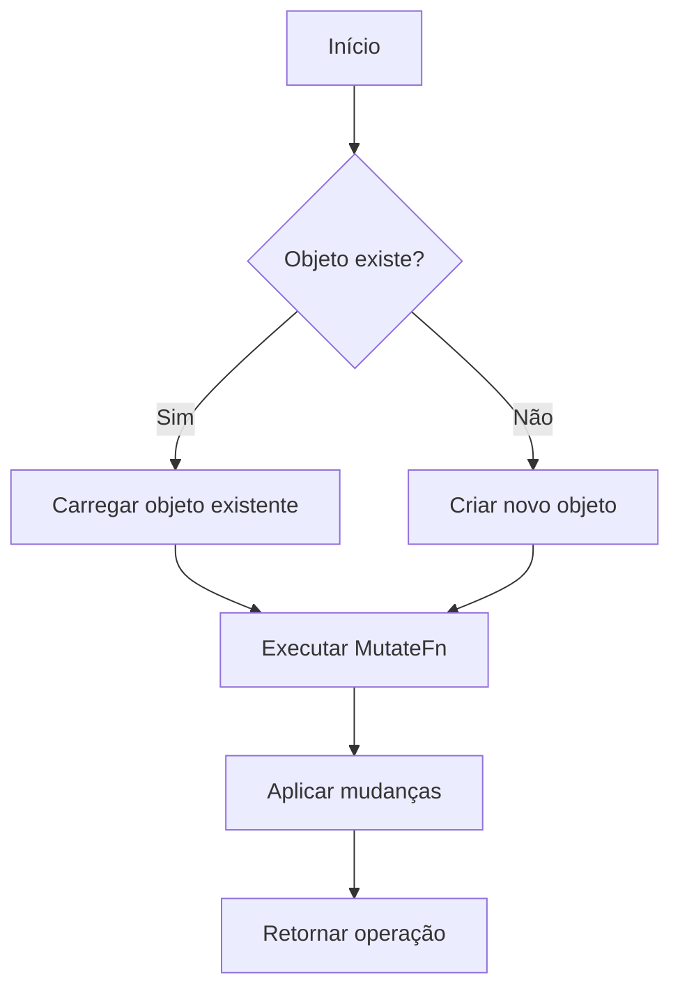
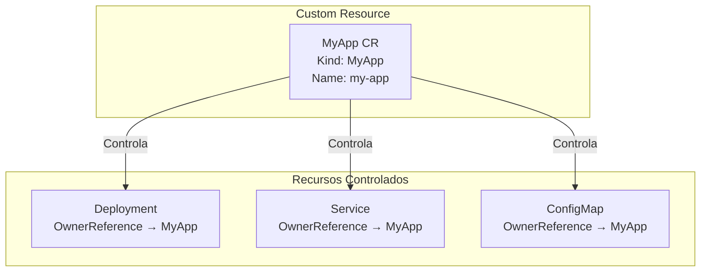
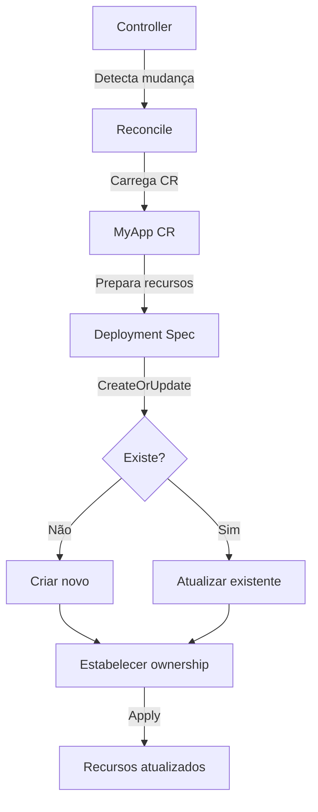

# Entendendo CreateOrUpdate e OwnerReferences no Kubernetes

## Padrão CreateOrUpdate

O padrão CreateOrUpdate é uma abstração comum em controllers Kubernetes que facilita a gestão de recursos, implementando a lógica de "criar ou atualizar" (upsert) de forma padronizada.

### Estrutura Básica
```go
op, err := ctrl.CreateOrUpdate(ctx, r.Client, deploy, func() error {
    r.specDeployment(app, deploy)
    return ctrl.SetControllerReference(app, deploy, r.Scheme)
})
```

A função de mutação deve definir só os campos que são do operator. Atribuir `deploy.Spec = ...` inteiro apaga o que o
API Server preencheu: no Service, o `clusterIP`. Cada reconcile vira uma escrita, ou um erro.

### Fluxo de Execução


## Owner References

OwnerReferences estabelecem relações hierárquicas entre recursos no Kubernetes, permitindo o gerenciamento automático do ciclo de vida dos recursos.

### Estrutura das OwnerReferences


### Exemplo de OwnerReference
```yaml
metadata:
  ownerReferences:
  - apiVersion: myapp.example.com/v1
    kind: MyApp
    name: my-app-instance
    uid: d9607e19-f88f-11e6-a518-42010a800195
    controller: true
    blockOwnerDeletion: true
```

## Implementação em Controllers

### Exemplo Completo
```go
func (r *MyAppReconciler) Reconcile(ctx context.Context, req ctrl.Request) (ctrl.Result, error) {
    // Carregar o CR
    app := &myappv1.MyApp{}
    if err := r.Get(ctx, req.NamespacedName, app); err != nil {
        return ctrl.Result{}, client.IgnoreNotFound(err)
    }

    // Preparar o Deployment
    deploy := &appsv1.Deployment{
        ObjectMeta: metav1.ObjectMeta{
            Name:      app.Name,
            Namespace: app.Namespace,
        },
    }

    // Criar ou atualizar
    op, err := ctrl.CreateOrUpdate(ctx, r.Client, deploy, func() error {
        // Configurar o Deployment
        r.specDeployment(app, deploy)
        // Estabelecer ownership
        return ctrl.SetControllerReference(app, deploy, r.Scheme)
    })
    if err != nil {
        return ctrl.Result{}, err
    }

    log.Info("Deployment reconciled", "operation", op)
    return ctrl.Result{}, nil
}
```

### Fluxo de Reconciliação com OwnerReferences


## Benefícios

1. **Idempotência**
   - Operações podem ser repetidas com segurança
   - Mesmo resultado independente do número de execuções

2. **Concorrência otimista**, não atomicidade. `CreateOrUpdate` é um ciclo *read-modify-write*: faz `GET`, aplica a
   função e só então `CREATE`/`UPDATE`. O ciclo **não** é atômico — outro escritor pode mudar o objeto entre o `GET` e o
   `UPDATE`. O API Server rejeita a escrita por `resourceVersion` desatualizada, e o controller reconcilia de novo. A
   segurança vem daí e da idempotência, não de uma transação.

3. **Consistência eventual**
   - Devolver erro recoloca na fila; a próxima passada reaplica o estado desejado
   - As owner references mantêm a integridade entre dono e filhos

4. **Rastreabilidade e ciclo de vida**
   - As owner references deixam a hierarquia explícita e facilitam o debugging
   - O filho é apagado quando o pai some (garbage collection)

## Boas Práticas

1. **Sempre `SetControllerReference` nos filhos** — é o que liga a deleção em cascata e o `Owns()`.
2. **Mantenha a função de mutação idempotente** — defina só os campos que são seus; não reescreva o que o cluster
   preenche (`clusterIP` do Service) nem campos imutáveis (o `selector` do Deployment: proteja com
   `if deploy.CreationTimestamp.IsZero()` se precisar defini-lo).
3. **Trate o conflito como normal** — `IsConflict` leva a um novo reconcile, não a um erro fatal.

## Considerações de Desempenho

- CreateOrUpdate faz uma chamada GET antes de CREATE/UPDATE
- OwnerReferences adicionam overhead mínimo
- O garbage collection é assíncrono
- Considere o impacto em clusters grandes

O padrão CreateOrUpdate combinado com OwnerReferences forma a base para uma gestão robusta e confiável de recursos em controllers Kubernetes.
