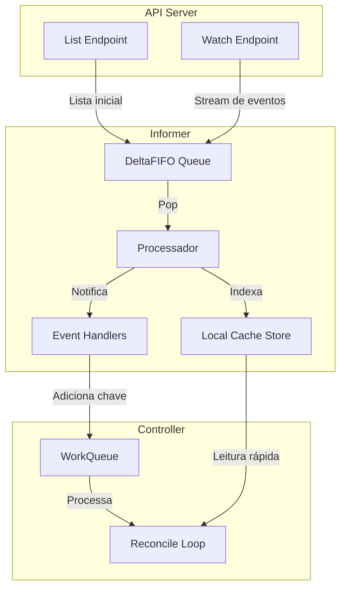
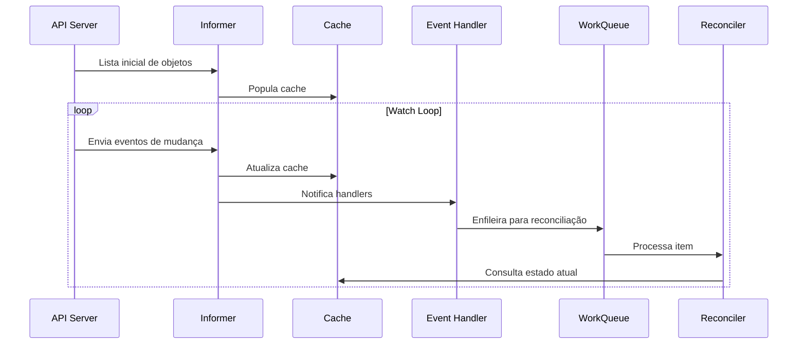
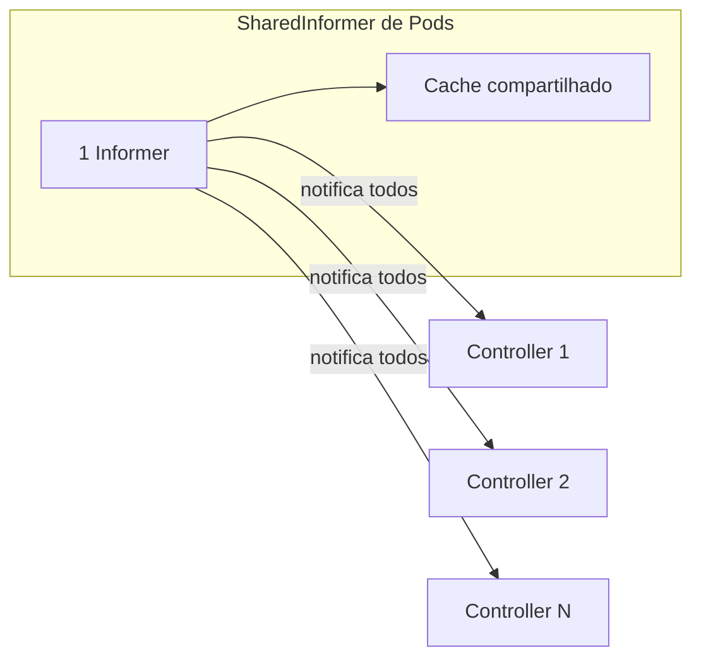
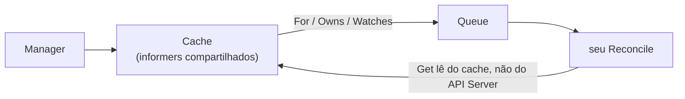

# Entendendo Informers no Kubernetes

## O que são Informers?

Informers são um padrão fundamental no Kubernetes que fornece um mecanismo eficiente para observar e reagir a mudanças nos recursos do cluster. Eles são especialmente importantes no desenvolvimento de Controllers e Operators.

## Arquitetura de Informers


## Componentes Principais

### 1. DeltaFIFO Queue

- Armazena eventos recebidos do API Server
- Mantém ordem FIFO para processamento
- Combina eventos duplicados
- Garante que nenhum evento seja perdido

### 2. Local Cache Store

- Mantém uma cópia local dos objetos
- Fornece acesso rápido sem consultar o API Server
- Suporta indexação para consultas eficientes
- Reduz carga no API Server

### 3. Event Handlers

- Reagem a eventos (Add/Update/Delete)
- Enfileiram trabalho para processamento
- Permitem lógica customizada por tipo de evento

## Fluxo de Informações


## Vantagens de Usar Informers

1. **Performance**
   - Reduz chamadas ao API Server
   - Cache local para consultas rápidas
   - Combinação de eventos duplicados

2. **Consistência**
   - Garante processamento ordenado
   - Mantém estado consistente
   - Previne perda de eventos

3. **Escalabilidade**
   - Eficiente em clusters grandes
   - Compartilhável entre controllers
   - Reduz carga no API Server

## Exemplo de Implementação
```go
// Criando um SharedInformerFactory
informerFactory := informers.NewSharedInformerFactory(client, time.Hour*24)

// Obtendo um informer específico
podInformer := informerFactory.Core().V1().Pods()

// Configurando handlers
podInformer.Informer().AddEventHandler(cache.ResourceEventHandlerFuncs{
    AddFunc: func(obj interface{}) {
        // Lógica para adição de objetos
        key, err := cache.MetaNamespaceKeyFunc(obj)
        if err == nil {
            queue.Add(key)
        }
    },
    UpdateFunc: func(oldObj, newObj any) {
        // Lógica para atualização de objetos
        key, err := cache.MetaNamespaceKeyFunc(newObj)
        if err == nil {
            queue.Add(key)
        }
    },
    DeleteFunc: func(obj interface{}) {
        // Lógica para deleção de objetos
        key, err := cache.DeletionHandlingMetaNamespaceKeyFunc(obj)
        if err == nil {
            queue.Add(key)
        }
    },
})
```

## Padrões de Uso

### SharedInformer Pattern

O ponto do *shared* informer é o oposto de um informer por controller: **um** informer por tipo de recurso, e vários
controllers consomem o mesmo cache e o mesmo watch.



Um único watch do tipo Pod alimenta todos os controllers que se interessam por Pods, reduzindo o consumo de recursos e
a carga no API Server.

## Informers no controller-runtime

No lab e no operator do treinamento você **não** instancia `SharedInformerFactory` à mão: o `Manager` do
controller-runtime já mantém um cache alimentado por informers compartilhados. Você só declara o que observar no
`SetupWithManager`, e o framework cria os watches e enfileira os `reconcile.Request`:



- `For(&MyApp{})` observa o recurso principal.
- `Owns(&appsv1.Deployment{})` observa os filhos (owner reference) — é o drift do lab.
- `Watches(...)` observa um tipo não-filho, mapeando o evento para o dono.

A API de client-go mostrada acima é o que roda **por baixo**; conhecê-la ajuda a depurar, mas o código que você
escreve no dia a dia é o `SetupWithManager`.

## Boas práticas

- **Leia sempre do cache** (o `Get`/`List` do client do manager), nunca direto do API Server: é o ganho do informer.
- **O cache pode estar atrasado** em relação ao cluster; o loop level-triggered absorve isso, mas não assuma que uma
  escrita sua aparece na leitura seguinte.
- **Espere o cache sincronizar** antes de reconciliar — o manager já faz isso no boot (`WaitForCacheSync`).
- **Resync** não é polling do API Server: reentrega os objetos do cache, útil como rede de segurança.

Voltar ao lab: [`03-desenvolvimento.md`](../03-desenvolvimento.md).
