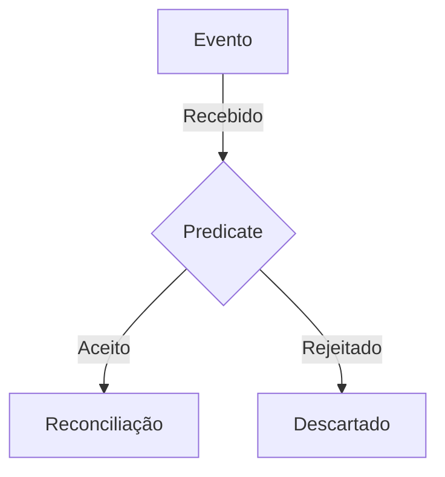
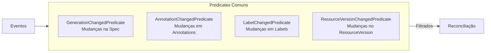
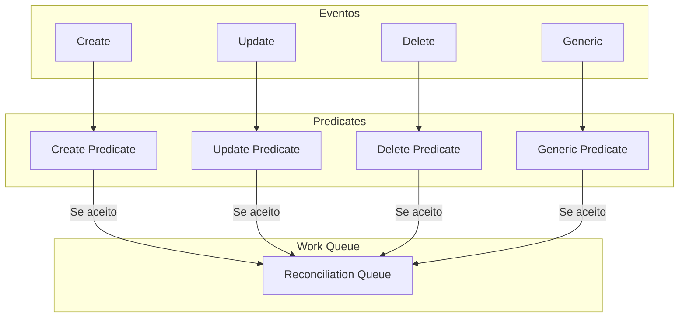

# Predicates no Kubebuilder

## O que são Predicates?

Predicates são filtros que determinam se um evento deve ou não disparar uma reconciliação. Eles ajudam a reduzir a carga no controller, evitando reconciliações desnecessárias.



## Tipos de Predicates



## Implementação de Predicates

### 1. Predicates Padrão

```go
// Usando um predicate padrão
func (r *MyAppReconciler) SetupWithManager(mgr ctrl.Manager) error {
    return ctrl.NewControllerManagedBy(mgr).
        For(&myappv1.MyApp{}).
        WithEventFilter(predicate.GenerationChangedPredicate{}). // só reconcilia quando a spec muda
        Complete(r)
}
```

`WithEventFilter` chamado mais de uma vez **não** substitui o filtro: o builder acumula os predicates e os combina por
**AND**. Para combinar de propósito, use `predicate.And(...)` ou `predicate.Or(...)` explícitos (abaixo), que deixam a
intenção clara.

### 2. Predicates Customizados

```go
// Predicate customizado
type MyCustomPredicate struct {
    predicate.Funcs
}

func (MyCustomPredicate) Create(e event.CreateEvent) bool {
    // Lógica para eventos de criação
    return true
}

func (MyCustomPredicate) Update(e event.UpdateEvent) bool {
    // Lógica para eventos de atualização
    oldApp := e.ObjectOld.(*myappv1.MyApp)
    newApp := e.ObjectNew.(*myappv1.MyApp)
    
    // Exemplo: reconcilia apenas se replicas mudaram
    return oldApp.Spec.Replicas != newApp.Spec.Replicas
}

func (MyCustomPredicate) Delete(e event.DeleteEvent) bool {
    // Lógica para eventos de deleção
    return !e.DeleteStateUnknown
}
```

## Fluxo de Eventos com Predicates



## Combinando Predicates

### 1. And Predicate

Combina múltiplos predicates com operação AND lógica.

```go
// Todos os predicates devem retornar true
predicate.And(
    predicate.GenerationChangedPredicate{},
    MyCustomPredicate{},
)
```

### 2. Or Predicate

Combina múltiplos predicates com operação OR lógica.

```go
// Pelo menos um predicate deve retornar true
predicate.Or(
    predicate.GenerationChangedPredicate{},
    predicate.LabelChangedPredicate{},
)
```

## Casos de Uso Comuns

1. **Ignorar Status Updates**

```go
type IgnoreStatusUpdatePredicate struct {
    predicate.Funcs
}

func (IgnoreStatusUpdatePredicate) Update(e event.UpdateEvent) bool {
    // Compara apenas a spec, ignora mudanças no status
    oldApp := e.ObjectOld.(*myappv1.MyApp)
    newApp := e.ObjectNew.(*myappv1.MyApp)
    return !reflect.DeepEqual(oldApp.Spec, newApp.Spec)
}
```

2. **Filtrar por Label**

```go
type LabelFilterPredicate struct {
    predicate.Funcs
    Label string
}

func (p LabelFilterPredicate) Create(e event.CreateEvent) bool {
    // Reconcilia apenas se tiver o label específico
    return e.Object.GetLabels()[p.Label] != ""
}
```

3. **Filtrar por Annotation**

```go
type AnnotationFilterPredicate struct {
    predicate.Funcs
    Annotation string
}

func (p AnnotationFilterPredicate) Create(e event.CreateEvent) bool {
    return e.Object.GetAnnotations()[p.Annotation] != ""
}
```

## Boas práticas

- **Prefira os predicates padrão** (`GenerationChangedPredicate` e afins): são testados e cobrem o caso comum de só
  reconciliar quando a spec muda.
- **Combine com `And`/`Or` explícitos**, não com `WithEventFilter` repetido, para a intenção ficar clara.
- **Cuidado com `Owns()`**: um `GenerationChangedPredicate` global descartaria as mudanças de status dos filhos, e o
  controller nunca veria as réplicas ficarem disponíveis. Aplique o predicate por recurso com `builder.WithPredicates`.
- **Teste o predicate** como função pura: dado um evento, aceita ou não.

Voltar ao lab: [`03-desenvolvimento.md`](../03-desenvolvimento.md).
